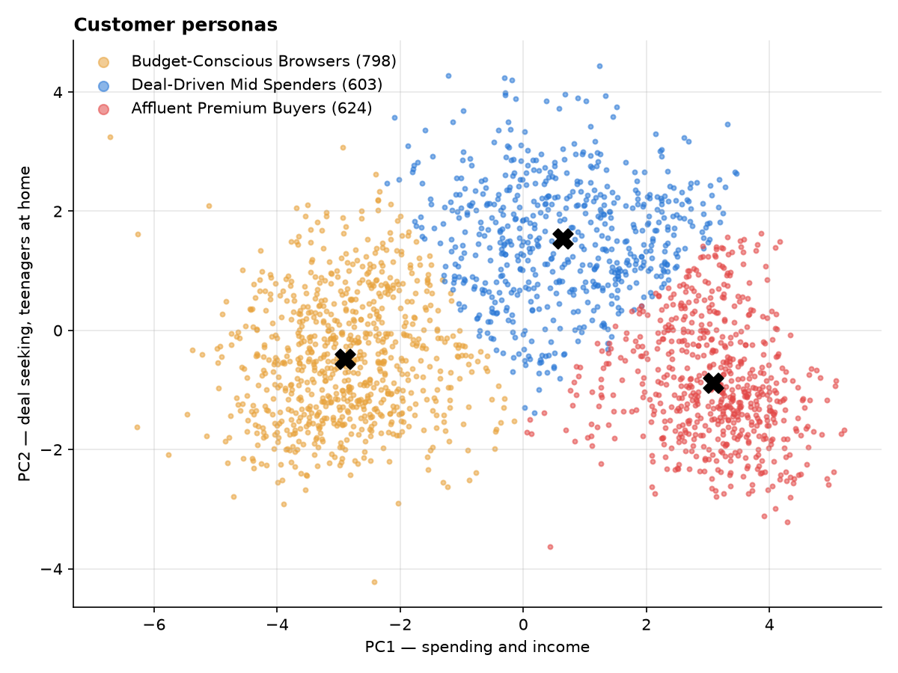
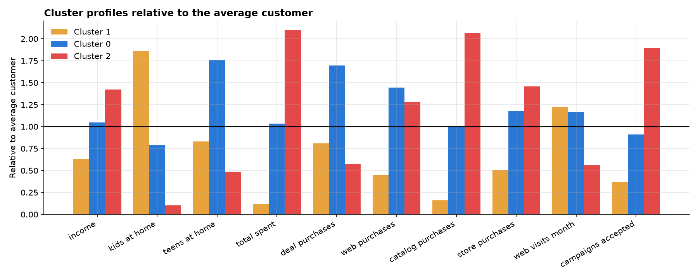
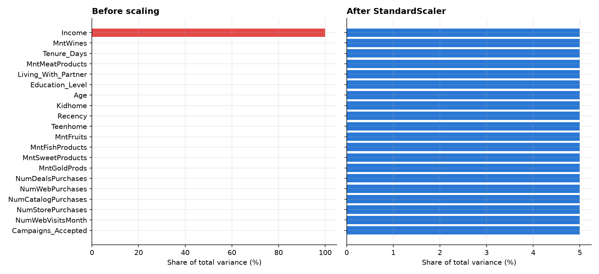
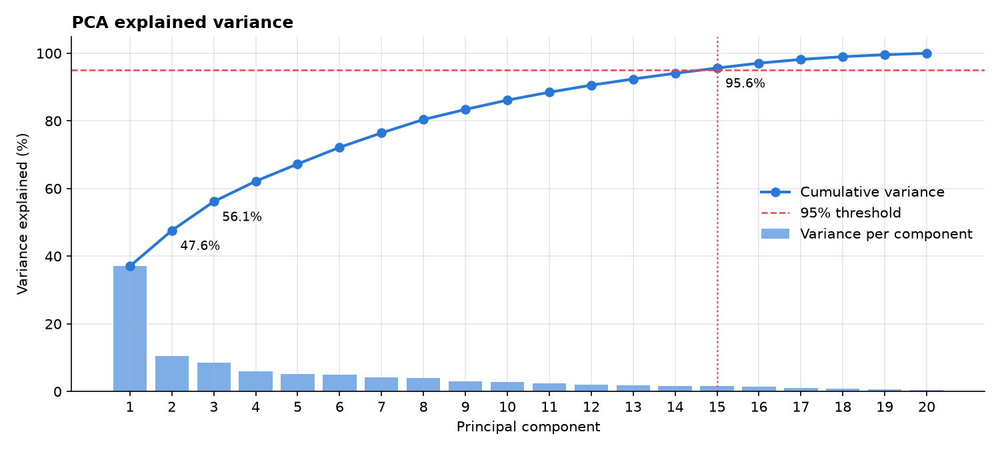
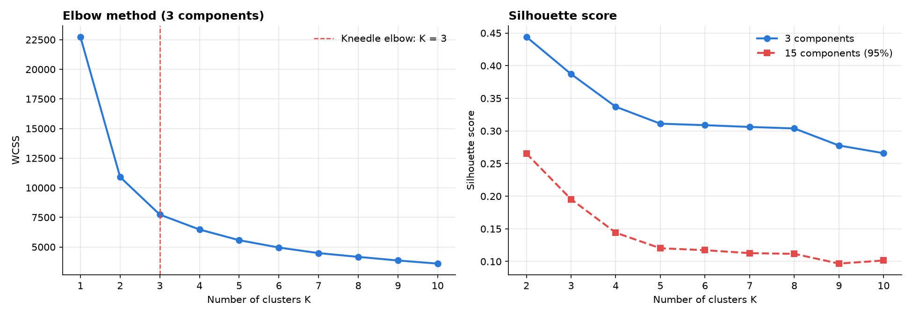
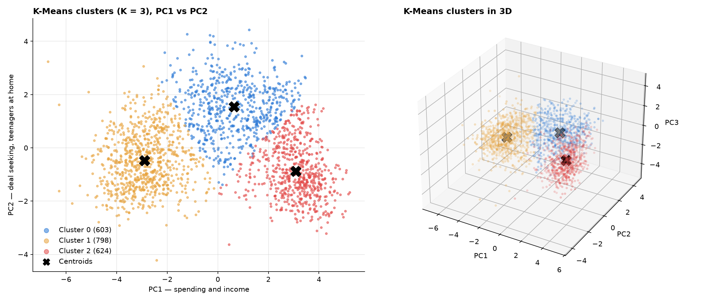

# Customer Segmentation — PCA, K-Means and Business Personas

**DecodeLabs Data Science Internship · Project 3 (2026)**

Unsupervised segmentation of 2,025 retail customers into three behavioural groups, translated into
business personas with concrete marketing actions. The pipeline follows
**Scale → Compress (PCA) → Cluster (K-Means) → Translate (Personas)**, and the number of clusters
is chosen with mathematical evidence (Kneedle elbow and silhouette score), not by eye.

📓 **Full walkthrough with outputs:** [`notebooks/customer_segmentation.ipynb`](notebooks/customer_segmentation.ipynb)

---

## Key finding

**A third of the customers generate almost two thirds of the revenue.** The *Affluent Premium Buyers*
are 30.8% of customers and 64.6% of total spend, and they respond to campaigns at nearly three times
the rate of the lowest-spending group.

## Personas

| Persona | Customers | Share of revenue | Avg income | Avg 2-year spend | What sets them apart | Business action |
|---|---|---|---|---|---|---|
| **Affluent Premium Buyers** | 624 (30.8%) | **64.6%** | 74,005 | 1,274 | catalogue purchases 2.07×, campaigns accepted 1.89×, last-campaign response 24.5%, almost no young children, fewest website visits (0.56×) | premium / loyalty programme, early access to wine and meat ranges, catalogue and in-store campaigns |
| **Deal-Driven Mid Spenders** | 603 (29.8%) | 30.8% | 54,477 | 628 | discounted purchases 1.70× (highest), teenagers at home 1.76×, oldest group (48.9) and longest tenure | targeted coupons and bundles to grow basket size without discounting the whole range |
| **Budget-Conscious Browsers** | 798 (39.4%) | 4.6% | 33,013 | 71 | website visits 1.22× but web purchases 0.45× — they browse but rarely buy; young children at home 1.86×; youngest group (41.6) | convert visits into orders: entry-price bundles, first-order discounts, retargeting of website visitors |

*× = value relative to the average customer.*





## Method and evidence

### 1. Data cleaning — 2,240 → 2,025 customers

| Issue | Rule | Removed |
|---|---|---|
| `Z_CostContact`, `Z_Revenue` constant | columns dropped | — |
| Invalid marital status (`Absurd`, `YOLO`); `Alone` → `Single` | rows dropped | 4 |
| Same customer recorded under two IDs | keep first | 183 |
| Missing income (1.07%) | rows dropped (< 5% rule) | 24 |
| Birth years 1893, 1899, 1900 | ages above 100 dropped | 3 |
| Income of 666,666 | above Q3 + 3 × IQR dropped | 1 |

Age and tenure are measured from the latest enrolment date in the data (2014-06-29), because the
dataset does not state its collection date.

### 2. Twenty clustering features

Age, income, education level, living with a partner, children and teenagers at home, tenure, recency,
spending on six product categories, deal / web / catalogue / store purchases, website visits and
number of campaigns accepted.

### 3. Scaling

Before scaling, **income held 99.95% of the total variance** — K-Means would have grouped customers
by income alone. After `StandardScaler` every feature holds an equal 5%.

The ten features with skew above 1 (mainly spending) were log-transformed first. This kept every
customer while reducing customers with an extreme value (|z| > 3) from **13.0% to 3.4%**.



### 4. PCA

| | Variance kept |
|---|---|
| 2 components | 47.6% |
| **3 components (used for clustering)** | **56.2%** |
| 15 components | 95.6% (95% rule) |

- **PC1 — spending and income:** meat, wine, catalogue purchases, income
- **PC2 — deal seeking and teenagers:** deal purchases, teenagers at home, website visits
- **PC3 — tenure and younger customers:** tenure (+), education (−), age (−)

The project requires 2–3 dimensions, while the 95% rule needs 15. Clustering is done in 3
dimensions and the result is checked against the 15-component space (see below).



### 5. Choosing K

| | 3 components | 15 components (95%) |
|---|---|---|
| Kneedle elbow | **K = 3** | **K = 3** |
| Best silhouette | K = 2 (0.444) | K = 2 (0.265) |
| Silhouette at K = 3 | 0.387 | 0.195 |

**K = 3** is the elbow in both spaces and has the second-highest silhouette, 0.057 below K = 2.
Comparing the two solutions shows that K = 2 merges the deal-driven customers into the other groups,
while K = 3 separates them as a distinct marketing segment.



### 6. Cluster quality

| Check | Result |
|---|---|
| Agreement with clustering in the 95% space (Adjusted Rand Index) | **0.965** |
| Overall silhouette | 0.387 |
| Silhouette per cluster | 0.447 / 0.270 / 0.429 (Affluent / Deal-Driven / Budget) |
| Customers with a negative silhouette | 0.0% / 4.1% / 0.3% |

An ARI of 0.965 means reducing to three dimensions barely changed any customer's cluster.



## Limitations

- A silhouette of 0.387 indicates moderately separated clusters; customer groups overlap, as is
  usual for behavioural data. The Deal-Driven group sits between the other two and has the most
  borderline customers (4.1% negative silhouette).
- Centroids translated back through 3 principal components are approximate (56.2% of the variance),
  so persona figures use the exact averages of each cluster's customers.
- The data covers customers enrolled between 2012 and 2014; segments should be refreshed on current data.

## Project structure

```
├── data/raw/README.md                  # dataset source and download steps (CSV not in repo)
├── notebooks/customer_segmentation.ipynb
├── reports/
│   ├── figures/                        # all charts produced by the notebook
│   └── persona_matrix.csv              # persona summary table
├── requirements.txt
└── README.md
```

## How to run

```bash
git clone https://github.com/nadiagul01/customer-segmentation.git
cd customer-segmentation

python -m venv .venv
# Windows:      .venv\Scripts\activate
# macOS/Linux:  source .venv/bin/activate
pip install -r requirements.txt
```

1. Download `marketing_campaign.csv` from
   [Kaggle](https://www.kaggle.com/datasets/imakash3011/customer-personality-analysis) into `data/raw/`.
2. Open `notebooks/customer_segmentation.ipynb`, select the `.venv` kernel and **Run All** (about one minute).

## Tech stack

Python · pandas · NumPy · scikit-learn (StandardScaler, PCA, KMeans, silhouette, ARI) · kneed · Matplotlib · Jupyter
